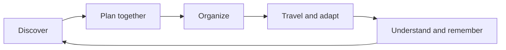
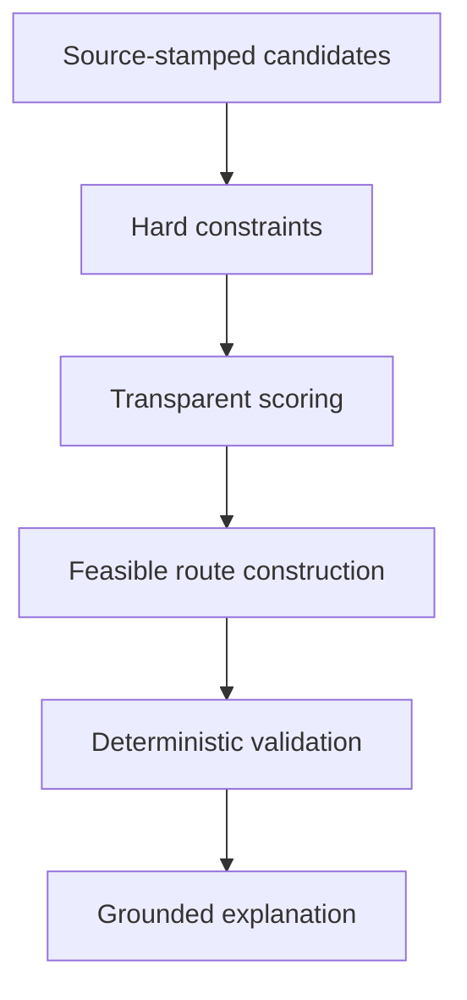
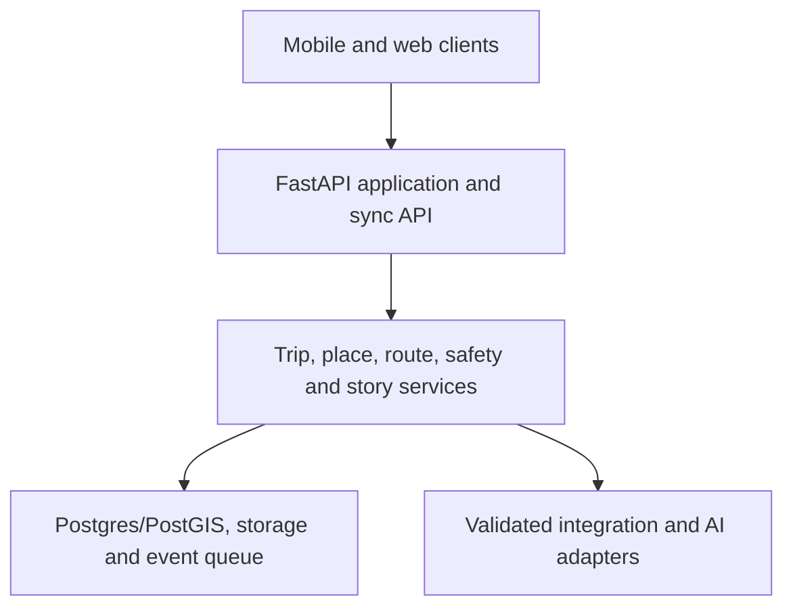

# GhumGham — Unified Product Master Plan

**Status:** Canonical single source of truth  
**Version:** 6.0 — Product Edition  
**Effective date:** 1 September 2026  
**Product:** Nepal-first, AI-native, privacy-respecting travel operating system  
**Working brand:** GhumGham (घुमघाम)

> **GhumGham keeps one journey coherent when preferences, people, reservations, connectivity and conditions change.**

---

# PART I — PRODUCT IDENTITY

## 0. DOCUMENT AUTHORITY

This document defines what GhumGham is, what it is not, how it works, what is built first, how claims are governed and how product decisions change.

### 0.1 Precedence

When documents disagree, use this order:

1. this master plan and its current version
2. an approved Architecture Decision Record incorporated into this master plan
3. implementation contracts and API schemas
4. milestone plans and issue trackers
5. derivative briefs, wall charts, presentations and earlier drafts

The following input documents remain useful reference material but are **not authoritative where they conflict with this version**:

- `GHUMGHAM_PRIORITY_DETAILED.md`
- `GHUMGHAM_PRIORITY_SHORT.md`
- `GHUMGHAM_TEAM_BRIEF.md`
- `GHUMGHAM_UNIFIED_MASTER_PLAN-revised.md`

### 0.2 Explicitly removed from the product source of truth

External eligibility, submission rules, presentation tactics, countdown schedules, prizes and temporary positioning do not belong in the product plan. They may exist in separate temporary documents and may never redefine the product.

### 0.3 Canonical decisions resolved in this version

| Previously inconsistent decision | Canonical decision |
|---|---|
| Dynamic replanning was sometimes T1 | **T0:** continuity under change is central to the product promise |
| SafePass was sometimes T1 | **T0:** bounded offline check-in and consent capsule are core; dispatch is not |
| Voice was sometimes T1 | **T0:** voice is an input mode for structured actions, always with text fallback |
| Guide Character was sometimes T1 | **T0, bounded:** one reviewed Place Lens package with known target, anchored hotspot and Hide Character mode |
| Place Lens was either a static slider or unrestricted camera recognition | **T0:** reliable known-target experience plus non-AR fallback; open-world recognition is T2/T3 |
| Validator and explainability were separate products | They are mandatory stages of the **Responsible Itinerary Engine** |
| “Local benefit” meant several different things | T0 reports verified/declaration-labelled local-stop share; monetary benefit requires attributable transactions and a published method |
| Destination privacy threshold was treated as universally safe | Threshold is configurable and must be tested for re-identification; a number alone is not a privacy guarantee |

### 0.4 Change control

A product decision changes only when all five are recorded:

1. problem and evidence
2. decision and alternatives considered
3. affected contracts, screens, data and risks
4. owner and effective version
5. migration and rollback plan

Any accepted decision must update this file in the same change. A roadmap item, prototype or conversation does not silently become product scope.

## 1. PRODUCT DEFINITION

### 1.1 One sentence

> **GhumGham converts a travel idea into a collaborative, constraint-valid and adaptable journey; keeps essential trip context available offline; connects travelers with suitable local providers and cultural knowledge; and preserves memories under precise user control.**

### 1.2 Vision

Become the trusted operating layer between imagining a journey and remembering it years later—starting in Nepal and expanding only when the trust, content and operating model can be reproduced responsibly.

### 1.3 Mission

Reduce the work and uncertainty of planning and managing travel while helping appropriate local providers participate fairly and giving destinations privacy-protected operational insight.

### 1.4 Product thesis

Travel is not one search result or one itinerary. It is a changing shared state composed of people, preferences, places, reservations, routes, budgets, sources, disruptions, permissions and memories. Existing products solve valuable slices of that lifecycle. GhumGham's product is the **continuity between the slices**, represented by one permissioned Trip Graph.

### 1.5 Nepal-first, not Nepal-limited

- Nepal is the first operating environment because offline gaps, fragmented supply, cultural sensitivity, difficult routing and itinerary disruption make continuity unusually valuable.
- The data model, source system, optimizer and permissions are geography-agnostic.
- Geographic expansion happens corridor by corridor, with local content governance and operating partners; a larger map is not the same as coverage.
- Never claim nationwide support while operational depth exists only in selected corridors.

## 2. THE PROBLEM AND THE ACTORS

### 2.1 Three connected problems

| Actor | Current problem | GhumGham outcome |
|---|---|---|
| Traveler or group | Ideas, routes, reservations, budgets, chats, safety information and memories live in disconnected tools; changes cause manual rebuilding | One explainable journey that remains coherent, collaborative and useful offline |
| Local host, guide, artisan, eatery or experience provider | Limited digital visibility, weak content and booking operations, and poor access to relevant demand | Fair, consented discovery and attributable requests from travelers whose needs genuinely match |
| Operator, destination or conservation body | Fragmented traveler operations and little privacy-safe evidence about demand, pressure or local-provider exposure | Configured trip operations plus aggregated, purpose-limited insight and content governance |

### 2.2 Primary beachhead

**User:** small groups planning two-to-seven-day cultural, community, nature or light-adventure journeys in Nepal.  
**First likely payer:** a tour operator or destination-management company that needs collaborative itinerary building and traveler operations.  
**Initial supply partners:** consented homestays, guides, artisans, eateries and experiences inside one well-curated corridor.  
**Institutional customer:** a destination or conservation organization after the traveler and partner workflows produce credible, privacy-safe evidence.

### 2.3 Jobs to be done

| Actor | Job |
|---|---|
| Traveler | “Turn our constraints and ideas into a feasible plan I can understand and change.” |
| Group organizer | “Resolve preferences without losing decisions, reservations or prior versions.” |
| Traveler in motion | “Tell me what is next and what changed even when connectivity is weak.” |
| Culture-focused visitor | “Help me understand and behave appropriately without fabricating history.” |
| Safety-conscious traveler | “Help me prepare and share only the emergency information I approve.” |
| Local provider | “Show my offer accurately to suitable travelers and prove whether it generates demand.” |
| Operator | “Create and manage dependable journeys without rebuilding data in several tools.” |
| Destination steward | “See useful aggregate patterns without exposing an individual's route.” |

## 3. PRODUCT CONSTITUTION

Every capability must advance at least one promise:

1. **Less planning work** — consolidate ideas, routes, reservations, documents and budgets.
2. **Better shared decisions** — roles, proposals, voting, version history and undo.
3. **More dependable travel** — offline continuity, explicit uncertainty and reversible replanning.
4. **More meaningful travel** — culture, etiquette, responsible alternatives and appropriate local providers.
5. **Controlled memories** — private-by-default Stories and portable archives.
6. **Fairer outcomes** — transparent ranking, attributable partner value and privacy-safe destination insight.

### 3.1 Non-negotiable principles

- **One journey, one Trip Graph.** Modules may have separate services, not separate truth.
- **Hard constraints before generative prose.** AI explains validated structures; it does not invent operational reality.
- **Unknown stays unknown.** Missing or stale data never becomes “safe,” “open,” “available” or “verified.”
- **Offline is a designed state.** The interface exposes offline, queued, synced and needs-review states.
- **Consequential changes require preview and confirmation.** Paid or locked items never change silently.
- **Source and freshness travel with the claim.** A URL alone is not operational proof.
- **Private by default.** Sharing is granular, revocable and never required to use the product.
- **Payment cannot buy organic trust.** Sponsorship is separate, visible and subordinate to safety and suitability.
- **Consent precedes exposure.** Sensitive places and community alternatives are not “discovered” into harm.
- **Accessibility has an equivalent path.** Voice, AR and visual storytelling always have text or non-AR alternatives.

### 3.2 Prohibited capabilities and claims

- guaranteed rescue, guaranteed safety or direct emergency dispatch without an authorized operational service
- medical diagnosis, personal altitude-illness probability, “safe to ascend,” treatment or clearance
- hidden sponsored ranking or pay-to-win recommendations
- raw precise-location or movement-data sale
- public continuous location sharing by default
- cashable tokens, tradable points or speculative rewards
- unreviewed AI reconstruction presented as historical evidence
- plant edibility, toxicity, animal-encounter safety or medical conclusions from camera recognition
- “all Nepal,” “real-time,” “verified,” “official,” “live inventory” or affiliation claims without evidence
- prototype listings represented as verified partners
- higher rewards for more dramatic damage reports
- authenticity certification without an accountable issuer and registry

### 3.3 Capability maturity

| State | Required evidence |
|---|---|
| **Operational** | Real data and integration, monitored behavior, support owner, incident procedure and documented fallback |
| **Pilot** | Named consenting partner, bounded users and geography, procedures, feedback and exit criteria |
| **Prototype** | Working behavior on seeded or explicitly test data; no claim of live operations |
| **Concept** | Architecture or research only; unavailable in the user product |

Every feature and integration has exactly one maturity state. Interface quality does not upgrade evidence.

### 3.4 Data and claim states

Maturity describes the capability. Verification describes the record. They must not be confused.

| State | Meaning |
|---|---|
| `unknown` | No adequate evidence |
| `unverified` | Recorded from a source but not confirmed with the subject or authority |
| `self_declared` | Supplied by the provider or contributor |
| `documented` | Supported by a reviewable document or authoritative record |
| `verified` | Checked under published criteria, by a named role, with an expiry date |
| `expired` | Prior verification is no longer current |
| `disputed` | Credible conflict requires review |

“Local ownership,” “accessible,” “open,” “available,” “safe,” “official” and “verified” are evidence-bearing fields, never decorative badges.

## 4. BRAND, NAVIGATION AND PRODUCT LAYERS

### 4.1 Brand status

`GhumGham` (घुमघाम, wandering/exploring) remains a working brand until Nepal company and trademark checks, domain availability, app-store availability and international pronunciation testing are complete.

### 4.2 Consumer navigation — exactly five tabs

| Tab | User promise | Primary contents |
|---|---|---|
| **Home** | Know what matters now | Next action, change notices, sync state, budget state, upcoming check-in |
| **Trip** | Manage the journey | Timeline, map, reservations, documents, budget, members, offline pack, versions |
| **Explore** | Discover responsibly | Places, experiences, culture, Responsible Alternatives, saved ideas |
| **Assistant** | Ask or act with context | Voice/text Copilot, explanations, translation, proposal and replan previews |
| **You** | Own identity and memories | Kathaharu, saved places, permissions, exports, privacy and account controls |

Booking, translation, safety and Place Lens appear contextually inside the journey. They are never separate top-level tabs.

### 4.3 Product layers

| Layer | Role |
|---|---|
| **Explore** | Discovery, saved ideas, cultural and local-provider context |
| **Trips** | Planning, collaboration, route, reservations, budget and documents |
| **Copilot** | Grounded conversational interface and authorized actions |
| **Go** | Offline state, next action, route continuity, translation and SafePass |
| **Place Lens** | Evidence-labelled interpretation and bounded spatial experiences |
| **Kathaharu** | Private memories, collaborative albums and archive |
| **Partner Hub** | Consent, listing operations, requests and attributable outcomes |
| **Destination Intelligence** | Thresholded aggregate insight, scenarios and content governance |

### 4.4 Lifecycle



The product must preserve context across every transition. A feature that creates a second disconnected itinerary, budget, permission model or place record violates the architecture.

## 5. PLACE COVERAGE AND INITIAL OPERATING CORRIDOR

### 5.1 Place model

“Place” supports cultural and built heritage, spiritual travel, nature and biodiversity, adventure, community and rural tourism, food and agriculture, craft and creative economy, festivals and living culture, wellness and slow travel, science and education, memory and disaster heritage, accessible and family travel, conservation and volunteering, urban discovery, and meetings or work travel.

Every place may carry:

- category, tags and sensitivity
- coordinates at exact or generalized resolution
- duration, cost range, effort and seasonality
- opening and access windows with source and expiry
- accessibility attributes and unknown states
- cultural protocol and content-review status
- provider relationships and local-ownership evidence
- operational restrictions and source-labelled conditions
- Place Lens package and evidence tier

Sensitive sacred, ecological or community locations may be generalized, guide-only or hidden. More discoverability is not automatically better.

### 5.2 Initial corridor

**Patan → Panauti → Namobuddha** is the first coherent product corridor—not the permanent boundary of the product.

- Patan validates culture, artisans, urban discovery and source governance.
- Panauti validates community tourism, homestays and local-provider operations.
- Namobuddha validates etiquette, walking, offline continuity and a lower-pressure alternative.

Initial content target:

| Record | Target | Quality rule |
|---|---:|---|
| Places | 25–30 | No surfaced operational fact without provenance |
| Consented providers | 8–10 | Status and consent shown separately from verification |
| Source records | 8–12 | Publisher, authority class, retrieval date and expiry where applicable |
| Reviewed Place Lens packages | 1 complete, then 3–5 | Evidence label and accessible fallback required |
| Responsible Alternatives | 3–5 | Consent, sensitivity and ability-to-receive-visitors checks |
| Route variants | At least 3 | Standard, less walking and lower cost/local-priority scenario |

---

# PART II — CANONICAL SCOPE AND PRIORITY

## 6. PRIORITY SYSTEM

The tiers describe product dependency and evidence—not how many hours a feature should take.

| Tier | Meaning | Admission rule |
|---|---|---|
| **T0 — Core Product** | Minimum complete GhumGham journey | Must be end-to-end, tested and coherent |
| **T1 — Product Completion** | Parity, commercial proof and operational depth | Begins only after the T0 journey passes |
| **T2 — Expansion** | High-value capability justified by validated demand | Requires owner, metric and data source |
| **T3 — Partner/Research Dependent** | Needs specialist data, supply or procedures | May be prototyped; never represented as live |
| **T4 — Contract/Regulatory Blocked** | Needs formal authorization, legal design or settlement operations | Architecture only until the blocker is removed |
| **T5 — Prohibited** | Violates the constitution | Never built regardless of revenue |

> **No T1 feature outranks a broken T0 journey. A screen is not complete; an acceptance test is.**

## 7. T0 — THE MINIMUM COMPLETE PRODUCT

The T0 journey is:

> **voice/text idea → constraint-valid shared plan → responsible alternative → offline trip pack → evidence-backed replan → Place Lens guide → SafePass check-in → private memory**

| # | Capability | Canonical behavior | Acceptance test |
|---:|---|---|---|
| 1 | **Trip Graph + five-tab shell** | One logical trip object connects people, preferences, sources, places, stops, decisions, locks, versions, consent and Stories. | One authorized edit updates every relevant surface without duplicate or contradictory state; unauthorized access fails at the API/data-policy layer. |
| 2 | **Ranked onboarding with text and voice** | Collect dates, start/end, budget, ranked interests, pace, walking limit, food/accessibility needs and group context. Voice fills the same typed structure. | Changing budget, pace or top-ranked interest changes the plan for an inspectable reason; text remains fully functional. |
| 3 | **Responsible Itinerary Engine** | Curated retrieval → hard filters → transparent scoring → feasible route construction → deterministic validation → grounded narration. | Produces a feasible multi-day plan and rejects seeded violations of budget, opening windows, travel time, locks, walking or accessibility. Narration cannot introduce an unknown stop. |
| 4 | **Map, timeline and smart route order** | Day views, route line, travel estimates, lock/undo and external navigation handoff. | Map and timeline remain synchronized; reordering preserves locks and produces a valid version. |
| 5 | **Collaborative planning and decisions** | Owner/editor/commenter/viewer roles, proposals, ranked voting, resolution, attribution and history. | Two users update one trip without data loss; a resolved proposal creates an explained new version and the prior version remains inspectable. |
| 6 | **Responsible Alternatives and local-benefit explanation** | Swap an unsuitable, high-pressure or mismatched stop for a consented relevant option. Show source, uncertainty, provider status and benefit basis. | Swap recalculates route/time/cost, preserves locks and never labels unknown ownership, pressure or sponsorship as verified. |
| 7 | **Offline trip pack** | Download itinerary, permitted map region, precomputed route, place and cultural cards, essential contacts, Lens package, SafePass and an operation queue. | In airplane mode the pack, map, Place Lens content and check-in open; mutations show queued and synchronize idempotently later. |
| 8 | **Dynamic replan with preview and rollback** | A source-labelled condition identifies affected stops, preserves paid/locked items, retrieves valid substitutes and shows time, cost and local-impact deltas. | No major change occurs before confirmation; acceptance creates a version; rollback restores the exact prior version. Test conditions are labeled simulated. |
| 9 | **Grounded Copilot, culture and one translation turn** | Voice/text assistant distinguishes fact, recommendation, estimate and unavailable; answers use authorized Trip Graph context and sources. | One sourced answer resolves its reference; one unsupported current-condition request is refused; one approved translation shows original and translation. |
| 10 | **Place Lens + animated Guide Character** | At one reviewed place, a known reference target or surveyed vantage launches a sourced experience; the character points to one authored hotspot. Character, Labels Only and Hide Lens modes are equal. | Target and pointer remain stable enough for supported devices; captions, source and evidence remain visible; unknown targets return unsupported rather than a guess; non-AR fallback completes the same learning goal. |
| 11 | **SafePass + bounded planning checks** | Offline QR/manual check-in, traveler-approved emergency capsule preview, official contact cards and source-backed ascent-plan rules for eligible overnight-altitude itineraries. | Check-in synchronizes once; capsule reveals only consented fields; missed check-in is not described as an emergency; no prediction, diagnosis, clearance or dispatch claim appears. |
| 12 | **Kathaharu privacy proof** | Create a photo, voice or text moment with Only me, Selected people, Trip group, Link and Public visibility. Private by default; exact location removable; metadata stripped. | A non-authorized account cannot retrieve the moment; visibility change is logged and revocable; deleted or expired access no longer works. |

### 7.1 T0 Definition of Done

Each capability requires:

- happy path, empty state, error state, offline/degraded state and unknown state
- automated acceptance test and named manual test where device behavior is involved
- capability maturity and record verification labels
- accessible alternative for voice, camera, audio and maps
- telemetry that does not capture sensitive content
- documented failure behavior and support owner
- no unresolved critical security, privacy, medical or cultural-content finding

## 8. T1–T5 CANONICAL MAP

### 8.1 T1 — product completion, in order

1. **Reservation import:** screenshot/PDF/email-forward → extraction confidence → traveler confirmation → locked timeline item.
2. **Budget ledger and group split:** planned versus actual, offline entries, payer/participants and non-shaming thresholds.
3. **Booking request and approved deep link:** availability request or provider handoff; no fake inventory or payment.
4. **Review-informed planning:** licensed, source-aware and manipulation-resistant signals; no fabricated reviews.
5. **Full two-way translation:** turns, transcript, original, replay and critical-phrase warning.
6. **Cross-platform continuity:** mobile traveler experience and web planning/operations surface using one Trip Graph.
7. **Kathaharu archive:** geotagged timeline, search, collaborative attribution, scrapbook and export.
8. **Sustainability summary:** published transport methodology, ranges, assumptions and alternatives; no moral score.
9. **Partner Hub proof:** consent, listing state and attributable impression → inclusion → request events.
10. **Destination Intelligence proof:** thresholded aggregate view with observed, estimated and unavailable inputs separated.
11. **Approved Lens pack:** three-to-five reviewed sites, multiple hotspots, Nepali/English content and offline assets.

### 8.2 T2 — expansion

- inspiration import from links, screenshots, notes and documents
- scenario comparison: lower cost, less walking, more local, lower-impact, more accessible
- document and ticket vault; calendar, PDF and GPX/GeoJSON export
- multi-modal routing adapters and nearby-facility discovery
- advanced group expenses and settlement suggestions
- guide profiles, availability requests and provider messaging
- route-condition reports with reporter class, timestamp, expiry and corroboration
- broader offline phrase packs and language coverage
- full memory products: lifetime map, recap, collaborative albums and photo-book export
- cultural quests and oral histories with contributor credit
- additional Place Lens sites and controlled spatial experiences
- open itinerary/place/story schemas and selected open-source privacy/offline tooling
- domain-specific visual recognition research for landmarks, mountains, plants or animals

### 8.3 T3 — partner or research dependent

- open-world landmark recognition beyond approved Lens packages
- plant, flower, animal and mountain recognition with expert-reviewed domain models and explicit unknown state
- historically reviewed 3D reconstructions
- computer-vision assistance for place-condition changes with mandatory human review
- production review-fraud and manipulation detection
- demand forecasting and destination-pressure calibration
- SMS/voice booking operations with actual provider procedures
- multi-language content operations beyond the supported launch languages
- public commercial APIs and self-hosted institutional distribution

### 8.4 T4 — blocked until authorization exists

| Capability | Required before activation |
|---|---|
| Payment, escrow, refund or cross-border settlement | Payment partners, legal/accounting design and dispute operations |
| Instant bookable inventory | Supplier contracts, availability interface and cancellation procedures |
| Rescue dispatch or insurer case creation | Signed partners, tested handoff, audited procedures and appropriate review |
| Digital permits or protected-area validation | Authorized government or park integration |
| Official capacity enforcement | Responsible authority and validated local thresholds |
| Artisan authenticity certification | Accountable issuer, registry and dispute process |
| Guide certification verification | Certifying-body agreement and current data |
| Government emergency broadcast ingestion | Official feed agreement and monitored operations |
| Transport ticket issue/change/refund | Operator contracts and settlement procedures |

### 8.5 T5 — prohibited

T5 is exactly the prohibited set in §3.2. It cannot be moved into another tier through sponsorship, user demand or a prototype label.

---

# PART III — EXPERIENCE AND DECISION CONTRACTS

## 9. THE TRIP GRAPH

The Trip Graph is a **logical domain graph implemented in relational PostgreSQL/PostGIS**, not a requirement for a graph database. Every node and relationship has permissions, provenance and version semantics.

### 9.1 Canonical domains

| Domain | Core entities | Non-negotiable rule |
|---|---|---|
| Identity and consent | user, profile, consent grant, device, role | Consent is purpose-specific, revocable and auditable |
| Sources and claims | source, claim, evidence, review, expiry | Operational claims carry provenance and freshness |
| Place and supply | place, provider, listing, availability, verification | Consent to list and verification are different states |
| Trip | trip, member, preference, constraint, stop, route, task | One trip version is canonical; every mutation is attributable |
| Decisions | proposal, option, vote, resolution | Group compromise creates an explainable version |
| Reservations and money | reservation, document, budget, expense, split | Extraction is provisional until traveler confirmation |
| Replan | condition, affected item, proposal, version, rollback | Locked/paid items are protected by default |
| Offline | pack manifest, local operation, sync receipt, conflict | Retried writes are idempotent; conflict never silently overwrites |
| Place Lens | package, target, hotspot, narration, evidence label | Unsupported target produces no invented identification |
| SafePass | capsule, consent scope, checkpoint, check-in, access event | Capsule data is isolated from analytics and recommendations |
| Kathaharu | Story, moment, media, ACL, share link, redaction | A moment can become more public only through explicit action |
| Partner outcomes | impression, save, inclusion, request, booking outcome | Attribution stages are distinct; exposure is not revenue |
| Destination insight | aggregation job, privacy policy, scenario, observation | Individual routes never leave as institutional analytics |

### 9.2 Source and claim model

Place-level provenance is too coarse for changing facts. Use claim-level records for opening hours, prices, permits, route status, accessibility, cultural statements and availability.

Each claim stores:

- subject and field
- normalized value and unit
- source publisher, URL or partner record
- authority class
- observed/retrieved time
- valid-until time or review cadence
- geography and seasonal scope
- reviewer and verification state
- conflict/dispute status

Source authority hierarchy:

1. official government, park, municipality, site, permit or emergency source
2. approved destination or provider record
3. recognized heritage, conservation or professional body
4. timestamped field observation with reporter class and corroboration
5. curated editorial
6. general web background, visibly labeled

When credible claims conflict, preserve both, lower confidence, show the conflict where relevant and route it to review. Never average incompatible facts into certainty.

### 9.3 Version and event semantics

- Every shared-trip mutation carries `trip_id`, `base_version`, actor, device, timestamp and idempotency key.
- Accepted mutations create an immutable event and a new materialized trip version.
- Replans, proposals and reservation imports remain drafts until confirmed.
- Check-ins and stewardship observations are append-only; corrections create linked review events.
- Story visibility and SafePass access changes create audit events.
- Provider verification and operational claims expire independently.

## 10. RESPONSIBLE ITINERARY ENGINE

### 10.1 Decision pipeline



The generative model receives only the validated structure and authorized source excerpts. It may explain, summarize or propose user-facing wording. It may not add, remove, reorder, retime or price stops.

### 10.2 Hard constraints

Hard constraints eliminate candidates before scoring:

- explicit closure, restriction or hidden sensitivity state
- incompatible opening/access window
- impossible travel time or day-end location
- budget or required-cost violation
- accessibility requirement not met
- dietary requirement where the place claim is sufficiently specific
- seasonal restriction or expired operational claim
- blocking route condition
- user exclusion, paid/locked conflict or consent restriction

Unknown accessibility, availability or safety does not pass as compatible. The engine either requests confirmation, offers a labeled uncertain option where non-safety-critical, or excludes it.

### 10.3 Transparent scoring

The initial experimental form is:

$$
S = w_P P + w_L L + w_C C + w_F F + w_D D + w_B B + w_A A - R
$$

Where preference match $P$, local-benefit evidence $L$, cultural/nature relevance $C$, freshness $F$, dispersal suitability $D$, budget fit $B$, accessibility fit $A$ and penalties $R$ are bounded and inspectable.

Default research weights may begin at:

`P=.28, L=.20, C=.15, F=.12, D=.10, B=.10, A=.05`

These are product hypotheses, not scientific facts. Hard constraints always dominate. Weights are versioned, tested for disparate outcomes and never secretly changed by sponsorship.

Scoring-state rules:

- a required accessibility need is a hard filter; $A$ may score only additional preferences after requirements pass
- local benefit $L$ uses the declared/documented/verified state and confidence; `unknown` is not converted into non-local or local
- dispersal $D$ is active only when a source-backed or explicitly modeled pressure state exists; unknown pressure is neutral
- freshness $F$ is calculated from the operational claims needed for that stop, not from a single place-level timestamp
- no factor may compensate for a hard safety, sensitivity, consent or feasibility failure

### 10.4 Route construction

The route builder must represent:

- travel-time matrix with source/provider and confidence
- opening windows and booked times
- dwell time, meals, rest and day-end constraints
- transport mode and transfer buffers
- group pace and walking ceiling
- accommodation and locked-item continuity
- uncertainty where routing coverage is weak

Feasibility outranks mathematical optimality. When no valid plan exists, return the blocking constraints and safe controls to relax; do not fabricate a route.

### 10.5 Display acceptance contract

A plan is displayable only when all applicable checks pass:

- each stop exists in the authorized candidate set
- required source and freshness fields exist
- route or travel time exists or is visibly unavailable
- time windows do not overlap and operating windows are respected
- locked reservations are preserved
- budget math identifies inclusions, exclusions and estimates
- walking/accessibility constraints hold
- accommodation, meals, rests and day-end locations are feasible
- stale facts are not narrated as current
- reasons, uncertainty and benefit basis can be shown
- narration references only validated entities and values

### 10.6 Explainability contract

Every recommendation can answer:

1. Why does this fit the stated constraints?
2. Why is it scheduled here?
3. Which facts are uncertain, estimated or stale?
4. What alternative was considered?
5. Who may benefit, and what evidence supports that claim?
6. Is any placement sponsored?

Do not show a pseudo-scientific “best place score” as truth. Show factor contributions and plain-language reasons.

## 11. RESPONSIBLE ALTERNATIVES AND LOCAL BENEFIT

“Hidden gem” is not a product state. An alternative is surfaced only when:

- the place/community has consented or an accountable manager has approved exposure
- the sensitivity policy permits discovery
- access, season and ability to receive visitors are known enough
- it matches the traveler's actual constraints
- routing remains feasible
- source, status and sponsorship are visible

### 11.1 Local-benefit measurements

| Metric | When valid | What it does not prove |
|---|---|---|
| **Local-listing share** | Stop has a labeled ownership-evidence state | That money was spent there |
| **Local-request share** | Traveler sent an attributable provider request | That a booking completed |
| **Local booking value** | Confirmed transaction outcome is available | How much value stayed locally |
| **Estimated local retention** | Published methodology and input evidence exist | Exact household/community income |

T0 may display only the first metric and its evidence state. Monetary impact enters the product only with attributable outcomes and a documented method.

## 12. DYNAMIC REPLANNING

Replanning is a rules-and-evidence workflow, not an AI rewriting a holiday.

### 12.1 Eligible triggers

- source-confirmed closure or restriction
- weather/hazard threshold from a named feed
- transport delay from a provider
- traveler running late
- budget deviation
- group decision
- accessibility change
- provider availability change
- source-labelled destination scenario

Triggers without live evidence are labeled test or simulated. A crowdsourced report carries reporter class, observed time, expiry and corroboration.

### 12.2 Replan algorithm

1. identify trigger, coverage and freshness
2. determine affected downstream items
3. preserve locked and paid items
4. retrieve candidates satisfying remaining constraints
5. rebuild only the affected portion
6. validate full-trip feasibility
7. preview removed/added items and time, cost, walking, uncertainty and local-benefit deltas
8. ask for approval from the authorized trip role
9. create a new version and retain exact rollback state

The system may recommend an action but cannot cancel, pay, message a provider or disclose safety information without the corresponding authorization and confirmation.

## 13. OFFLINE CONTINUITY AND SYNC

### 13.1 Trip pack

An offline pack includes only licensed and authorized assets:

- itinerary and selected versions
- regional map resources and precomputed route geometry
- place facts, cultural cards and source metadata
- confirmed reservations/documents chosen for offline storage
- essential contacts and language cards
- supported Place Lens package
- SafePass configuration and check-in queue
- sync manifest, expiry states and last successful update

Offline maps mean downloaded map resources plus precomputed route context. They do not imply current traffic or full offline routing for every mode.

### 13.2 Authority by data class

| Data | Authority while offline | Conflict policy |
|---|---|---|
| Unsynced private note or moment | Device | Append/create, then apply ACL on sync |
| Shared itinerary edit | Device draft | Optimistic version check; rebase or ask user |
| Check-in/observation | Device event | Append once using idempotency key |
| Provider verification or official claim | Last server snapshot | Never locally upgrade status |
| Expired route condition | None | Show expired/unavailable, never extend silently |
| Paid/locked reservation | Last confirmed server state | Preserve; conflict requires explicit review |

### 13.3 Operation queue contract

Each queued operation stores a stable operation ID, actor, device, base version, encrypted payload where required, retry count and creation time. The server returns a receipt keyed by the same operation ID. Retrying the same operation cannot duplicate a check-in, expense, vote or Story moment.

The visible states are exactly: `offline`, `queued`, `syncing`, `synced`, `conflict`, `needs_review`, `expired`, `unavailable`.

## 14. COPILOT, VOICE AND TRANSLATION

### 14.1 Copilot is an interface, not a separate truth

Copilot reads only authorized Trip Graph context and tool results. It must not bypass the itinerary engine, permissions, integration gateway or confirmation rules.

| Answer class | Required presentation |
|---|---|
| **Source-backed fact** | Source, scope and last-checked date |
| **Recommendation** | Reasons, alternatives and uncertainty |
| **Estimate** | Range, assumptions and timestamp |
| **Unavailable** | Explicit limit plus the safest useful next step |

### 14.2 Action policy

| Action | Behavior |
|---|---|
| Read/explain | Retrieve authorized data; cite the claim source |
| Draft | May draft itinerary, message, translation, budget item or Story |
| Shared mutation | Preview collaborators affected; preserve history and undo |
| Communication | Show recipient, original and translation; require send confirmation |
| Reservation/commerce | Show provider, amount and policy; explicit confirmation and idempotency |
| Safety disclosure | Show exact fields, purpose and recipient; log access |
| Destructive privacy action | Show target and export option; require explicit confirmation |

### 14.3 Voice

- Voice produces the same typed intents and fields as text.
- Transcription is shown before consequential execution.
- Text is always available; voice is never a single point of failure.
- Retention and third-party speech processing are disclosed.
- Destructive, shared, financial and disclosure actions require visual confirmation.

### 14.4 Translation

- Display original and translated text together for important communication.
- Let the user replay, edit or decline before sending.
- Mark low confidence and warn that medical, legal, financial and emergency meaning needs qualified confirmation.
- Store only what is needed for the trip and selected communication history.
- Provide offline phrase cards for supported contexts; do not present them as a universal interpreter.

### 14.5 Grounding and refusal

The assistant refuses when the needed data is outside supported geography, expired, conflicting, not authorized or high-consequence without a reliable source. A refusal should state what is missing, when the available data was checked and which official or qualified channel can help. It never fills the gap with general web prose presented as current fact.

## 15. PLACE LENS AND THE GHUMGHAM GUIDE

Place Lens has two related experiences:

1. **Experience Lens:** etiquette before arrival, sourced cultural context, evidence-labelled Then/Now, short audio, accessible interpretation and artisan/community context.
2. **Stewardship contribution:** registered vantage, ghost alignment, comparable capture, neutral structured form, offline storage and later review.

### 15.1 Evidence labels

| Label | Meaning |
|---|---|
| `historical_photograph` | Authentic photograph from the stated source and period |
| `documentary_reconstruction` | Reconstruction based on named archaeological, architectural or documentary evidence |
| `artistic_interpretation` | Creative impression; not evidence of the historical appearance |

AI-assisted imagery is labeled `artistic_interpretation` unless a named expert and review process justify a different class. The content record stores reviewer, source, version and review date.

### 15.2 Bounded T0 Guide Character

At one reviewed landmark:

1. user opens Lens from the supported Place record
2. the offline Lens package loads
3. a known image/reference target or surveyed vantage activates the authored experience
4. the animated character introduces the place and points to one registered hotspot
5. sourced narration, captions, evidence label and contributor credit remain visible
6. user can choose **Character**, **Labels Only** or **Hide Lens**
7. unsupported recognition asks for realignment or returns “not supported”

The character is a presentation layer. It cannot generate unsourced facts, diagnose an object, expose a sensitive location or make an operational claim.

### 15.3 Non-AR and accessibility equivalence

The same content is available through a Then/Now slider or image, text description, transcript, replay controls and screen-reader-friendly hotspot list. Lens is usable without camera permission. Motion reduction, mute and captions are required.

### 15.4 Technical boundary

- The mobile product uses an Expo **development build**, because true native AR/image tracking cannot rely on Expo Go.
- The Lens runtime is isolated behind a contract: `loadPackage`, `recognizeTarget`, `placeHotspot`, `playNarration`, `setMode`, `recordEvidence`.
- Known-reference image tracking is the initial method. ARCore and AR Foundation support detecting configured reference images; this is materially different from recognizing arbitrary real-world objects.
- A short device-support and integration spike selects either an AR Foundation module or native platform implementation; the host Trip Graph contract must not change.
- Unsupported devices receive the non-AR experience, not a broken camera screen.

### 15.5 Open-world recognition boundary

Landmarks, mountains, plants and animals are separate domains with different datasets and safety implications. Each future package requires:

- licensed domain data and geography coverage
- confidence calibration and explicit unknown result
- expert review and red-team cases
- source attribution and update procedure
- no edibility, toxicity, wildlife-safety or medical conclusion
- a non-camera search/browse alternative

## 16. SAFEPASS AND ASCENT-PLAN CHECK

### 16.1 SafePass purpose

SafePass improves preparation and selective information handoff. It is not a rescue provider, location surveillance service or guarantee of response.

Core elements:

- traveler-selected itinerary/route and expected check-in windows
- one or more traveler-selected contacts
- QR, lodge, guide or manual check-in
- encrypted, purpose-limited capsule
- exact disclosure preview and revocable consent
- official contact cards and explicit operating limitations
- append-only check-in and capsule-access audit

A missed check-in means only **“a planned check-in has not been recorded.”** It does not prove distress. Automated disclosure or external escalation requires an authorized procedure and connectivity; otherwise the product shows the agreed next step and contact information.

### 16.2 Capsule minimization

Potential fields are individually selectable: name/alias, trip identifier, planned route segment, last recorded checkpoint, chosen contact and optional traveler-entered note. Health information is excluded by default and, if a later qualified program permits it, is separately encrypted, purpose-limited and never used for personalization, analytics or ranking.

Capsule plaintext never appears in logs, prompts, crash reports or general analytics.

### 16.3 Ascent-plan check

The check compares **planned sleeping altitudes** with a versioned set of general planning rules from a named medical/professional source. It may flag a rapid sleeping-altitude gain or missing acclimatization/rest consideration and offer a route-edit suggestion.

It never:

- estimates a person's probability of altitude illness
- uses symptoms to diagnose or treat
- says a plan or person is safe
- clears a traveler to ascend
- replaces a guide or travel-medicine clinician

Required output:

- affected day and sleeping-altitude change
- rule text, source, edition and last review
- neutral message: “Review this segment with a qualified guide or clinician”
- option to add a rest/acclimatization day as an unapproved draft
- medical-limit disclaimer visible at the point of use

Any symptom report exits the planning flow and directs the traveler to qualified/official guidance; the product does not reason clinically.

## 17. KATHAHARU — MEMORY WITH CONTROL

Kathaharu turns what actually happened into a private, portable travel archive without requiring publication.

### 17.1 Privacy hierarchy

```text
Trip default → Story default → Moment override
```

A moment may become more private automatically. Making it more public requires explicit action.

| Visibility | Meaning |
|---|---|
| **Only me** | Author only |
| **Selected people** | Explicit access list; suitable for friends/family |
| **Trip group** | Accepted members of that trip |
| **Link** | Revocable, optionally expiring link |
| **Public** | Discoverable according to publication policy |

### 17.2 Privacy controls

- hide exact coordinates and keep only a coarse area
- strip EXIF and other location metadata by default
- delay publication to reduce live-location inference
- show completed route segments rather than live position
- simplify route geometry before sharing
- exclude a named collaborator from a specific moment
- revoke links and selected-person access
- export in an open format
- delete moment, Story, trip archive or account subject to clearly disclosed lawful/operational retention

Authorization is enforced in the API and database policies, not only by hiding interface elements.

### 17.3 Memory features by stage

- T0: create, private/share, location redaction, access proof
- T1: searchable timeline, collaborative attribution, scrapbook and export
- T2: lifetime map, trip reflection, recap, photo-book pipeline and delayed publishing

Reflection prompts are optional and neutral. Kathaharu does not provide therapy, diagnosis, counseling or unsolicited religious instruction.

## 18. PARTNER HUB

### 18.1 Provider lifecycle

`unverified → contacted → consented → documented/verified → expired/suspended`

Consent to list, local-ownership evidence, identity checks, professional certification and product maturity are separate fields.

### 18.2 Core functions

- phone/OTP or assisted onboarding
- listing, language, accessibility, photos, pricing and blackout dates
- consent and verification records with expiry
- request-to-book and approved deep-link flows
- traveler messaging with translation and confirmation
- attributable events: impression, save, itinerary inclusion, request, confirmed outcome
- training and assisted content creation in Nepali
- dispute, suspension and correction workflow
- labeled sponsored inventory that never modifies organic scoring

Basic tools remain free until measurable value is demonstrated. A provider should not pay merely to exist in the database.

### 18.3 Marketplace boundary

GhumGham does not represent availability, booking, payment, cancellation or refund as operational until the responsible provider/integration and procedures exist. A request is not a booking; an inclusion is not a request; a request is not revenue.

## 19. DESTINATION INTELLIGENCE

Purpose-limited destination outputs may include:

- thresholded, coarse visitor-flow summaries
- provider-exposure and attributable-request distribution
- configured destination or route scenarios
- time-slot and Responsible Alternative suggestions
- structured observation coverage and review queue
- Place Lens content governance
- source freshness and data-quality coverage
- waste, water or facility scenarios only when inputs and assumptions are documented

### 19.1 Privacy and inference rules

- Aggregate before data leaves the database.
- Suppress small cells using a configurable `k_min` plus spatial and temporal coarsening.
- Test repeated-query and linkage attacks; `k_min = 5` may be a pilot baseline, not a universal privacy guarantee.
- Do not expose an individual's route, precise origin/destination pair or Story data.
- Separate observed, estimated, modeled and unavailable fields.
- Allow travelers to opt out of non-essential analytics.

Call capacity outputs **scenario models**, never official carrying capacity unless the responsible authority supplies validated thresholds and approves their use.

---

# PART IV — TECHNICAL ARCHITECTURE

## 20. REFERENCE STACK

| Layer | Canonical choice | Product reason |
|---|---|---|
| Mobile | React Native + Expo + TypeScript using a development build | Cross-platform product with native camera, maps, secure storage and AR access |
| Navigation and state | Expo Router, TanStack Query, Zustand | Separates navigation, server cache and local UI state |
| Offline data | Expo SQLite, filesystem cache and secure key storage | Structured offline source plus protected sensitive material |
| Maps | MapLibre React Native with licensed styles/sources and offline packs | Open map renderer with regional offline support |
| Web | Next.js + TypeScript | Collaborative planner, Partner Hub and Destination Intelligence |
| Application backend | Python + FastAPI | Typed domain APIs, optimizer/AI integration and testability |
| Primary data | Supabase Postgres + PostGIS | Relational Trip Graph, geospatial queries and transactional versions |
| Identity/storage/realtime | Supabase Auth, Storage and RLS-governed Realtime | Shared identity, signed media access and collaboration |
| Queue/cache | Redis-backed queue/cache when workload requires it | Replan, extraction, notifications and retriable background work |
| AI orchestration | Provider adapters, typed tools, retrieval, validators and evaluation gates | Avoids provider lock-in and keeps models behind policy |
| Retrieval | Curated claim/source store + lexical/vector retrieval + reranking | Resolvable, freshness-aware answers |
| Observability | OpenTelemetry/Sentry-compatible traces, audit events and privacy-safe metrics | Reliability without logging sensitive content |

### 20.1 Stack boundaries

- Expo Go is not the production runtime for MapLibre native/offline and AR capabilities; use a development build.
- FastAPI owns business rules, versions, authorization-sensitive mutations and AI tool orchestration.
- Supabase Auth issues identity; the backend validates its token. Client-side direct database access is limited to explicitly approved RLS-protected flows.
- Service-role credentials never enter a client application.
- Map content and offline caching must respect the style, tile and data provider's license; public community tile servers are not an unlimited production backend.

## 21. SYSTEM ARCHITECTURE



### 21.1 Service boundaries

| Service | Responsibility |
|---|---|
| Identity and Consent | Account, membership, role, purpose, grant and revocation |
| Source and Place Intelligence | Claims, places, providers, culture, freshness and sensitivity |
| Trip Graph | Preferences, stops, reservations, documents, budgets, decisions and versions |
| Route and Replan | Matrix, route feasibility, trigger evaluation, preview and rollback |
| Offline Sync | Pack manifests, operation queue, conflict policy and receipts |
| Copilot | Intent, authorized tool use, retrieval, answer classes and confirmations |
| Communication | Collaboration, comments, votes, translation and outbound messaging |
| Place Lens | Reviewed packages, target recognition, hotspots, narration and observations |
| SafePass | Capsule, checkpoints, check-ins, access audit and planning-rule notices |
| Kathaharu | Moments, media, ACLs, sharing, archive and deletion |
| Partner | Consent, verification, listing, requests and outcome attribution |
| Destination | Aggregation, privacy thresholds, scenarios and content review |

Start as a **modular monolith** with explicit boundaries, one relational database and a background worker. Split services only when scale, isolation or ownership evidence justifies operational complexity.

## 22. API AND INTEGRATION CONTRACTS

### 22.1 API rules

- versioned `/v1` routes and generated OpenAPI
- Supabase identity token validated by FastAPI
- object-level authorization on every trip, Story, SafePass and partner resource
- `Idempotency-Key` required on retriable creates/actions
- optimistic concurrency using version/ETag for shared mutations
- structured errors with code, safe message, retryability and trace ID
- pagination and field limits on collections
- signed, short-lived media access
- no sensitive value in URL, analytics or logs

### 22.2 Core API families

```text
/v1/trips                 /v1/trips/{id}/members
/v1/itineraries           /v1/trips/{id}/versions
/v1/proposals             /v1/proposals/{id}/votes
/v1/replans               /v1/replans/{id}/accept|rollback
/v1/packs                 /v1/sync/operations
/v1/places                /v1/places/{id}/lens
/v1/copilot/turns         /v1/translation/turns
/v1/safepass              /v1/check-ins
/v1/stories               /v1/stories/{id}/moments
/v1/imports/reservation   /v1/budgets|expenses
/v1/partners              /v1/booking-requests
/v1/destination/summary   /v1/observations
```

Payment, order, permit, rescue or official-capacity endpoints are absent from operational API documentation until their T4 blocker is removed.

### 22.3 Integration gateway

Every adapter declares capabilities, geography, data permission, freshness, cost, rate limit, health, fallback and maturity state.

| Integration | Required controls | Degraded behavior |
|---|---|---|
| Maps/routing | attribution, caching license, route confidence | offline region and last validated geometry |
| Weather/hazard | source, timestamp, geography, threshold | last checked plus unavailable state |
| Transport | supplier identity and change/refund rules | stored reservation and provider contact |
| Stay/guide | consent, verification, sponsorship and cancellation | request or approved deep link |
| Document import | permission, malware scan, confidence review | manual add/edit |
| Translation/speech | retention choice, original text, confidence | offline phrase cards |
| Messaging | recipient approval, opt-out, rate limit and status | local draft/contact card |
| Emergency/insurance | contract and audited purpose-limited access | official downloadable contacts |
| Reviews/social | license, provenance, privacy and manipulation controls | curated content/manual save |
| Carbon | published method, range and assumptions | qualitative comparison |

An adapter response never becomes canonical Trip Graph data without normalization, validation and claim provenance.

### 22.4 Open-core boundary

Publish interoperable itinerary, trip-pack, place, route and Story export schemas. Open-source selected privacy-critical parsers, offline-pack tooling and reference clients where doing so improves trust and ecosystem adoption. Keep managed supplier contracts, fraud/risk operations, private destination configurations and commercial integrations inside the hosted service. Every user can export their own data without buying a self-hosted deployment.

## 23. SECURITY, PRIVACY AND DATA GOVERNANCE

### 23.1 Access invariants

- Enable Row Level Security on every exposed traveler-, trip-, Story-, message-, document-, partner-private and SafePass table.
- Active trip membership permits reading only within that trip; role separately governs edit, invite, vote and ownership actions.
- Every FastAPI resource lookup applies object-level authorization even when database RLS also exists.
- Service credentials remain server-side and are scoped by environment and function.
- SafePass, precise coordinates, private media and identity data are excluded from general analytics and model prompts.
- Destination aggregation and suppression occur before rows leave the database.
- Revoked consent blocks future non-essential processing and starts the documented deletion/restriction workflow.

### 23.2 Data classes

| Class | Examples | Minimum controls |
|---|---|---|
| Public content | approved place description, public source | provenance, review, license, correction |
| Account data | email/phone, profile | access control, minimization, encryption, deletion process |
| Trip-private data | preferences, budget, reservation, document | membership/role checks, encryption, audit, export |
| Precise location | check-in, exact Story coordinate | explicit purpose, coarse sharing, short access path, no resale |
| Safety-sensitive | SafePass capsule, optional note | isolation, envelope encryption, access preview, purpose/time limit, audit |
| Institutional aggregate | coarse counts and scenarios | thresholding, re-identification testing, purpose restriction |

Retention periods are not invented in product copy. Before a Pilot or Operational release, the owner must approve a data inventory, purpose, processor, geography, retention period, deletion behavior and legal review for each class.

### 23.3 Threat model

| Threat | Primary controls |
|---|---|
| Account takeover | secure authentication, session/device review, rate limits, sensitive-action reauthentication |
| Insecure direct object access | object-level authorization, RLS, negative access tests |
| Precise-location leakage | default private/coarse, delayed sharing, signed media, no sensitive analytics |
| Malicious document/media | type/size allowlist, malware scan, isolated processing, metadata stripping |
| Prompt injection from sources | source isolation, typed tools, instruction/data separation, output validation |
| AI unauthorized action | tool allowlist, role check, preview, confirmation, idempotency and audit |
| Sync overwrite/duplication | version check, operation IDs, append-only events, conflict UI |
| Provider fraud/pay-to-play | separate verification dimensions, expiry, dispute and labeled sponsorship |
| Capsule exposure | separate encryption keys, purpose-limited decrypt, no logs, access alerts |
| Aggregate re-identification | suppression, coarsening, repeated-query controls and privacy review |

### 23.4 Security release gates

- access-control matrix tests for every role and visibility state
- RLS and API authorization tests, including negative cases
- secret and dependency scanning
- upload and parser abuse tests
- prompt-injection and unauthorized-tool tests
- offline database and backup inspection for sensitive plaintext
- rate-limit and idempotency tests
- audit-log integrity and redaction review
- incident owner and rollback procedure

## 24. AI QUALITY AND RELEASE GATES

AI is a replaceable component behind contracts. Product correctness must not depend on a model following a paragraph of instructions.

### 24.1 Evaluation set

Maintain versioned cases across:

- itinerary feasibility and no-solution behavior
- preference and group-decision sensitivity
- paid/locked-item preservation
- source freshness, conflict and citation resolution
- cultural accuracy and evidence labeling
- accessibility and dietary hard constraints
- medical/safety boundary and correct refusal
- prompt injection and unauthorized action
- translation preservation of critical meaning
- Responsible Alternative sensitivity/consent rules

### 24.2 Metrics

- schema-valid rate
- hard-constraint violation rate
- route-feasibility rate
- citation resolvability
- unsupported-claim rate
- correct refusal rate
- replan lock-preservation and exact rollback rate
- recommendation diversity and local-ownership evidence coverage
- latency, cost per managed trip and degraded-mode success
- human cultural-review disagreement rate

Any fabricated citation, unauthorized consequential action, medical clearance, private-data leak, hidden sponsorship or critical route violation is a release blocker—not an acceptable average.

### 24.3 Human review

Human review is mandatory for:

- cultural protocol and sensitive-location content
- documentary reconstructions and historical claims
- provider verification and disputes
- official/emergency/permit source onboarding
- visual recognition domain releases
- changes to ascent-plan rule sources or language
- destination privacy configuration

### 24.4 Product quality and accessibility gates

- Publish the supported OS/device matrix; unsupported AR never blocks the non-AR journey.
- Test the complete offline pack on a low-end supported device and interrupted network.
- Show pack size, region and expiry before download; verify pack integrity after download.
- Set and measure release-specific budgets for startup, map interaction, itinerary generation, sync recovery and battery/storage use.
- Prevent critical journey data loss across app restart, process termination and retry.
- Test backup restoration and version rollback, not merely backup creation.
- Target [WCAG 2.2 AA](https://www.w3.org/TR/WCAG22/) for web surfaces and equivalent native semantics, focus order, touch targets, contrast, captions and alternatives on mobile.
- Support reduced motion, text scaling, screen readers, keyboard navigation on web, captions and non-voice/non-camera paths.

---

# PART V — BUSINESS, DISTRIBUTION AND DEFENSIBILITY

## 25. MARKET POSITION

AI itinerary generation, maps, route ordering, collaboration, reservation organization, budget tools, offline access, journaling and personalized recommendations are established capabilities. GhumGham cannot win by claiming any one of them as unique.

Official product material checked on 1 September 2026 shows [Wanderlog](https://wanderlog.com/plan-a-trip) spanning itinerary, map and budgeting and its app listing describing collaboration and reservation organization; [TripIt](https://www.tripit.com/web) organizes forwarded booking confirmations and offers travel alerts; [Polarsteps](https://www.polarsteps.com/) covers planning, route capture, stories and reliving.

### 25.1 GhumGham's wedge

1. constraint-valid shared planning rather than generic itinerary prose
2. source/freshness-aware local and cultural intelligence
3. responsible, consented alternatives instead of indiscriminate “hidden gems”
4. offline continuity plus versioned, rollback-safe replanning
5. evidence-labelled Place Lens with a bounded Guide Character
6. grounded assistant that distinguishes fact, recommendation, estimate and unavailable
7. consent-controlled SafePass without rescue or medical promises
8. private-by-default Kathaharu connected to what actually happened
9. partner and destination outcomes connected to the same trip lifecycle

### 25.2 Landscape

| Product/category | Established strength | GhumGham focus |
|---|---|---|
| [Wanderlog](https://wanderlog.com/) | Broad collaborative itinerary organization | constraint arbitration, Nepal operations, evidence and replan trust |
| [TripIt](https://www.tripit.com/web) | Reservation ingestion and itinerary organization | planning, group decisions, local/cultural journey and memory |
| [Roadtrippers](https://roadtrippers.com/) | route-first road-trip discovery and organization | multi-modal Nepal journeys, cultural context and local-provider operations |
| [Sygic Travel](https://travel.sygic.com/) / [TripHobo](https://www.triphobo.com/) | destination content and day scheduling | source/freshness transparency, constraint validation and responsible alternatives |
| [Google Maps](https://www.google.com/maps) | mapping, place coverage and navigation | permissioned trip context, documents, decisions, offline pack and Stories |
| [Polarsteps](https://www.polarsteps.com/) | route/story capture and reliving | connect memory to planning, changes, local providers and privacy controls |
| [AllTrails](https://www.alltrails.com/) and trekking apps | trail content and offline route use | complete multi-modal journey plus SafePass and cultural/local context |
| [Mindtrip](https://mindtrip.ai/) and AI-first planners | conversational discovery and polished plan generation | deterministic constraints, claim provenance, authorized actions and refusal |
| [KDE Itinerary](https://apps.kde.org/itinerary/) | privacy-first reservation extraction and open formats | local-first principles plus collaboration, decisions and managed simplicity |
| [AdventureLog](https://adventurelog.app/) | open-source/self-hosted travel archive | open schemas plus a managed journey and institutional option |
| [ghumNepal](https://www.ghumnepal.com/) / [HoneyGuide](https://honeyguideapps.com/) | Nepal-specific stays, routes or trekking depth | multi-context continuity, Responsible Alternatives and source-governed operations |
| Heritage/AR apps | immersive site interpretation | reviewed Lens inside a complete adaptable journey |
| [Questo](https://questoapp.com/) / [Augtraveler](https://www.augtraveler.com/) | game-like or AR-guided place experiences | evidence-labelled interpretation tied to trip, privacy and local outcomes |
| Homestay/provider networks | authentic supply and community relationships | partner/inventory relationship; integrate rather than displace |

### 25.3 Defensibility sequence

1. permissioned Trip Graph spanning decisions, reservations, operations and memories
2. source-stamped Place/Provider Graph with Nepal-specific depth
3. tested offline and change-management workflows
4. verified outcome data from inclusion through completed booking
5. trust, consent, verification and cultural-review operations
6. distribution partnerships with operators, communities and destinations
7. open interchange formats that make GhumGham the trusted context layer

The moat is not an LLM or a 3D character. It is trusted context, supply, permissions, operations and outcomes.

## 26. BUSINESS MODEL

People pay for a dependable travel outcome and operational capability—not for chatbot message counts.

| Customer | Offer | Revenue experiment |
|---|---|---|
| Operator/DMC | Collaborative itinerary builder, reservation organization, traveler operations and configured content | per-seat, per-managed-trip or managed SaaS |
| Destination/conservation organization | Configured corridor pack, content governance, aggregate console, exports and training | fixed-scope paid pilot |
| Traveler/group | Core planning free; advanced offline regions, collaboration, translation and premium archive | per-trip group pass or annual Pro |
| Local provider | Consent-based listing, requests, translation and outcome analytics | free basic; professional tools after measurable value |
| Booking/referral supplier | Completed booking or qualified attributable outcome | category-specific commission; never charge for uncompleted exposure |
| Memory customer | Premium export, scrapbook or photo book | product margin |
| Developer/institution | Approved APIs or self-hosted/open-core edition | usage or support contract |
| Sponsor | Clearly labeled responsible experience or stewardship campaign | campaign fee; never organic-rank influence |

### 26.1 Revenue order

1. operator/DMC itinerary and traveler-operations SaaS
2. paid configured destination/corridor pilots
3. commission after reliable supply and completed-outcome attribution
4. traveler/group Pro
5. partner professional tools and approved APIs
6. memory products and ethical campaigns

### 26.2 Go-to-market sequence

1. sign one operator/DMC design partner for the initial corridor
2. obtain consent and accurate content from a small set of providers
3. run a bounded traveler cohort and observe planning-to-trip continuity
4. prove offline use, replan trust, provider requests and privacy behavior
5. sell the operator workflow; separately test a destination insight pilot
6. expand to the next corridor only when content and operations meet the same quality gate

### 26.3 Unit economics and commercial metrics

- cost per reviewed place and Lens package
- cost per configured corridor
- active trips per operator seat
- itinerary acceptance and revision rate
- inclusion → request → confirmed outcome conversion
- gross booking value and take rate where authorized
- map, storage, speech and AI cost per managed trip
- provider activation, response time and retention
- destination contract value and support cost
- traveler repeat and paid conversion

All pricing is a hypothesis until willingness-to-pay evidence exists. Do not present forecasts as traction.

### 26.4 Data policy as strategy

- traveler owns precise trip and Story data
- collect the minimum for a stated purpose
- contributions are opt-in and separately revocable
- institutional analytics are aggregate and thresholded
- emergency data is segregated from marketing and recommendations
- raw movement-data resale is prohibited
- sponsorship is explicit and separated from organic relevance

---

# PART VI — METRICS, ROADMAP AND OPERATIONS

## 27. PRODUCT METRICS

### 27.1 North-star metric

**Successfully Managed Trips:** a trip with an accepted constraint-valid plan and at least one meaningful in-trip action, completed without a critical integrity failure such as lost locks, unauthorized access, fabricated operational fact or unrecoverable sync conflict.

This measures continuity, not app opens or generated itineraries.

### 27.2 Lifecycle metrics

| Stage | Measures |
|---|---|
| Discover | suitable-place save rate, reason expansion, alternative acceptance, unknown/source coverage |
| Plan | plan acceptance, hard-constraint pass, revisions to acceptance, collaboration resolution time |
| Organize | confirmed import accuracy, reservation lock coverage, planned budget completeness |
| Travel | offline pack success, queued-operation recovery, replan acceptance/rollback, unavailable-state correctness |
| Understand | Lens completion, caption/text alternative use, cultural correction rate |
| Remember | private Story creation, deliberate sharing, access-revocation success, export completion |
| Partner | consented listings, response rate, inclusion-to-request, confirmed outcome and disputes |
| Destination | aggregate coverage, suppressed-cell rate, scenario use and observation review time |

### 27.3 Trust guardrails

- critical constraint violations: target zero
- fabricated citations/operational claims: target zero
- unauthorized data access: target zero
- silent paid/locked change: target zero
- duplicate offline events: target zero
- medical clearance or rescue guarantee: target zero
- hidden sponsorship: target zero

Targets for non-critical product metrics are set only after baseline measurement.

## 28. MILESTONE ROADMAP

Milestones are outcome gates, not calendar promises.

### M0 — foundation and evidence

**Build:** domain contracts, source/claim model, authentication, RLS policy matrix, initial corridor content, design system and integration licenses.  
**Exit:** every surfaced place/claim has provenance; negative access tests pass; five-tab shell and one seeded Trip Graph operate.

### M1 — core private alpha

**Build:** complete T0 journey, mobile development build, offline pack, deterministic engine, collaboration, replan, bounded Lens, SafePass and Kathaharu.  
**Exit:** all twelve T0 acceptance tests pass end to end on supported devices, including airplane-mode and unauthorized-access tests.

### M2 — corridor pilot

**Build:** T1 reservation/budget/translation, 3–5 Lens packages, consented providers, web planner and basic Partner Hub.  
**Exit:** named consenting cohort uses real corridor content; provider response and traveler trust evidence exist; support/incident procedures work.

### M3 — first commercial product

**Build:** operator workspace, repeatable corridor configuration, partner outcome attribution, billing for SaaS/pilot, destination aggregate proof.  
**Exit:** at least one paying design partner, repeatable onboarding, known unit cost and no unresolved critical trust issue.

### M4 — multi-corridor Nepal scale

**Build:** content operations, second/third corridors, routing/language expansion, quality dashboards, partner verification operations and broader distribution.  
**Exit:** corridor quality is reproducible without founding-team manual intervention for every record.

### M5 — platform expansion

**Build:** approved APIs, open schemas, self-hosted options, new geography playbook and selected T2/T3 features.  
**Exit:** expansion passes local governance, content, safety, privacy and unit-economics gates—not merely technical deployment.

## 29. WORKSTREAM OWNERSHIP

| Workstream | Owns |
|---|---|
| Product | master plan, prioritization, metrics, research and change control |
| Mobile | five-tab experience, offline runtime, maps, Lens host and device quality |
| Web | collaborative planner, Partner Hub and Destination Intelligence |
| Backend/data | Trip Graph APIs, PostGIS, RLS, versions, sync and integrations |
| AI/decision systems | optimizer, validator, retrieval, tool policies and evaluation |
| Content/culture | source claims, cultural review, Lens packages and corrections |
| Design/accessibility | design system, interaction clarity, non-AR/voice alternatives and usability |
| Privacy/security | threat model, access tests, incident process, retention and vendor review |
| Partnerships/operations | provider consent, verification, support, operator workflow and outcome confirmation |

Every release has one accountable owner for product integrity, security/privacy, content accuracy and operations. “The AI did it” is never an ownership model.

## 30. RISK REGISTER

| Risk | Likelihood/impact | Mitigation and product language |
|---|---|---|
| Product becomes an incoherent super-app | High/High | One Trip Graph, five tabs, T0 dependency test; “many capabilities, one journey” |
| Thin or stale place data | High/High | claim-level source/freshness, bounded corridors, expiry and unavailable state |
| AI creates unsafe/impossible plan | Medium/High | hard filters, deterministic validation, tool policy, refusal and release blockers |
| Replan causes cost or lost reservation | Medium/High | protect locks, preview delta, role approval, exact rollback |
| Connectivity destroys usability | High/High | SQLite pack, licensed offline maps, operation queue and degraded states |
| Offline sync loses group work | Medium/High | version checks, idempotency, attribution, conflict interface and tests |
| Privacy/location harm | Medium/High | minimization, RLS, coarse/delayed sharing, segregation and access audit |
| SafePass creates false reliance | Medium/High | explicit limitations, no dispatch promise, consent preview and partner gate |
| Altitude feature becomes medical advice | Medium/High | planning-only inputs/language, source review, no symptoms/risk score/clearance |
| Cultural fabrication or exposure | Medium/High | named review, evidence labels, sensitivity controls and correction workflow |
| Provider fraud or pay-to-play | Medium/Medium | state separation, expiry, disputes and sponsorship isolation |
| AR fails across devices | High/Medium | bounded reference target, device matrix and equivalent non-AR path |
| Map/offline license violation | Medium/High | approved providers, attribution, cache policy and usage monitoring |
| Institutional analytics re-identify users | Medium/High | aggregation before access, suppression/coarsening and privacy testing |
| Slow institutional sales | High/Medium | operator/DMC first-payer path and staged destination offer |
| Costs scale faster than revenue | Medium/High | per-trip cost metrics, caching, bounded AI, pack-size and provider limits |
| Brand conflict or poor global recall | Medium/Medium | trademark/domain/app-store and international user testing before investment |

## 31. OPERATING CHECKLIST

Before any capability moves to Pilot or Operational:

1. scope, owner and user outcome are defined
2. data sources, licenses, geography and freshness are recorded
3. happy, error, offline, conflict and unknown states work
4. authorization, privacy and accessibility tests pass
5. analytics exclude sensitive content and measure the intended outcome
6. support, incident and rollback procedures exist
7. maturity and verification labels match reality
8. commercial and external claims have evidence
9. T4 dependencies are actually removed where relevant
10. this master plan and affected contracts are updated

---

# PART VII — DECISIONS, HYPOTHESES AND SOURCES

## 32. LOCKED DECISIONS

- GhumGham is a travel operating system, not merely an itinerary generator, chatbot, marketplace, AR app or institutional dashboard.
- Consumer navigation remains exactly Home, Trip, Explore, Assistant and You.
- The Trip Graph is the logical source of journey truth and uses relational PostgreSQL/PostGIS initially.
- The product is Nepal-first and expands through operationally deep corridors.
- T0 is the twelve-capability journey in §7.
- Voice and the Guide Character are interfaces over structured/sourced behavior, not independent brains.
- Place Lens T0 is bounded to reviewed known targets with a complete non-AR path.
- Offline continuity and rollback-safe replan are product identity.
- SafePass is preparedness and selective handoff; no rescue promise.
- Altitude support is a source-backed itinerary rules check, never prediction or diagnosis.
- Organic ranking is separate from sponsorship.
- Precise trip and Story data are not sold.
- FastAPI owns application/AI business rules; Supabase provides Postgres/PostGIS, identity, storage and governed realtime.
- MapLibre offline and native Lens capabilities require a development build, not Expo Go.
- Begin as a modular monolith; split services only when evidence justifies it.
- Business priority is operator/DMC SaaS, then configured destination products, then transaction and traveler revenue.

## 33. HYPOTHESES TO VALIDATE

- the initial corridor is the best first proof of cross-context value
- ranked preferences materially improve plan acceptance
- local-benefit weighting improves relevance without reducing feasibility or fairness
- travelers trust a visibly uncertain/refusing assistant more than an always-answering one
- groups value versioned compromise enough to adopt a shared planner
- offline continuity and replan produce repeat use, not only novelty
- local providers value attributable requests more than generic exposure
- operators will pay before a broad consumer subscription business matures
- destinations value configured aggregate insight enough for a paid pilot
- users understand and use per-moment privacy controls

Each hypothesis needs an owner, experiment, metric and decision date in the product backlog. It must not be written as proven fact.

## 34. OPEN DECISIONS

| Decision | Required evidence | Owner |
|---|---|---|
| Final brand clearance | Nepal trademark/company, domain, app-store and pronunciation checks | Product/Legal |
| Exact Lens runtime | supported-device spike comparing native and AR Foundation integration | Mobile |
| Offline map provider/style | licensing, Nepal coverage, download size, reliability and cost | Mobile/Backend |
| Partner verification standard | consent, identity, ownership and service-quality procedure | Partnerships |
| Destination privacy policy | threat model, legal review, `k_min`, spatial/time coarsening and query controls | Privacy/Data |
| First operator design partner | workflow fit, data access, willingness to pay and support capacity | Business |
| Retention schedule and processors | data inventory, jurisdiction, purpose and deletion feasibility | Privacy/Legal |
| Launch language set | user demand, content quality, translation operations and support | Product/Content |
| Local-benefit methodology | ownership evidence, transaction attribution and independent review | Data/Impact |
| Ascent-rule governance | qualified clinical review, source versioning and change procedure | Safety/Product |

## 35. VERIFIED REFERENCE BASE

### 35.1 Technical feasibility

- [Expo — add custom native code](https://docs.expo.dev/workflow/customizing/): a development build supports native code/configuration unavailable in Expo Go.
- [MapLibre React Native — OfflineManager](https://maplibre.org/maplibre-react-native/docs/modules/offline-manager/): regional resources can be managed as offline packs, subject to source/style licensing.
- [Supabase — Row Level Security](https://supabase.com/docs/guides/database/postgres/row-level-security): database-enforced authorization for exposed data.
- [Supabase — PostGIS](https://supabase.com/docs/guides/database/extensions/postgis): geospatial types and queries in PostgreSQL.
- [ARCore — Augmented Images](https://developers.google.com/ar/develop/augmented-images): detection/augmentation of configured 2D reference images.
- [Unity AR Foundation — image tracking](https://docs.unity3d.com/Packages/com.unity.xr.arfoundation@6.1/manual/features/image-tracking.html): cross-platform reference-image tracking abstraction.

### 35.2 Medical boundary for the planning check

- [Wilderness Medical Society 2024 altitude-illness guideline record](https://pubmed.ncbi.nlm.nih.gov/37833187/)
- [CDC Yellow Book — High-Altitude Travel and Altitude Illness](https://www.cdc.gov/yellow-book/hcp/environmental-hazards-risks/high-altitude-travel-and-altitude-illness.html)

These sources justify only a general planning-rule comparison and safety messaging. They do not justify a personal predictor, diagnosis or clearance. Any implemented rule set must identify the exact source edition and receive appropriate review.

### 35.3 Nepal content governance

- [Nepal Tourism Board — tourism statistics](https://trade.ntb.gov.np/downloads-cat/nepal-tourism-statistics/)
- [Government of Nepal — Nepal Tourism Statistics 2025](https://tourism.gov.np/content/711/nepal-tourism-statistics-2025/)
- [UNESCO — Nepal World Heritage properties](https://whc.unesco.org/en/statesparties/np)
- [UNESCO — Kathmandu Valley](https://whc.unesco.org/en/list/121/): one World Heritage property with seven Monument Zones.

Never imply UNESCO affiliation. Use primary/current sources for operational claims and attach last-checked dates.

### 35.4 Claims excluded until proven

Do not use unsourced percentages or amounts for tourism-income concentration, rural spending, planning hours, complaint rates, middleman margins, seasonal concentration, imported crafts, homestay digitization, heritage dwell time or route-specific altitude deaths.

Do not claim live trail conditions, a rescue integration, a transaction, a verified provider, an official capacity limit, cultural authenticity or nationwide coverage because a database field or prototype exists.

## 36. FINAL PRODUCT RULE

> **Do not build the widest travel app. Build the most coherent, trustworthy, locally intelligent and disruption-resilient journey—and prove each expansion preserves that standard.**

**GhumGham — Imagine it. Plan it together. Travel confidently. Remember everything.**

---

*End of canonical master plan · Version 6.0 · 1 September 2026*
